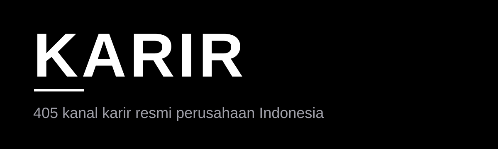
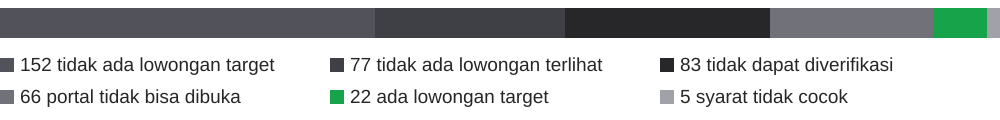

  

406 kanal karir resmi, dicek satu per satu di browser. 22 di antaranya ada lowongan buat gudang, produksi, cleaning, office boy, packing, dan crew store.

<h3 align="center"><a href="https://karir-adiprmx.vercel.app/">Cari loker sekarang</a></h3>

Tanpa akun, tanpa login, tanpa pembayaran. 
Dicek langsung di browser tanggal 4-5 November 2026.

## 22 perusahaan dengan lowongan target

Klik satu perusahaan buat lihat status, lokasi, dan tanggal ceknya. Cek lagi syarat lengkapnya di portal resmi sebelum melamar.

<table>
<tr>
<td align="center" width="50%">
<a href="https://karir-adiprmx.vercel.app/perusahaan/115">

 Super Indo
</a>
 DC Staff Gudang
</td>
<td align="center" width="50%">
<a href="https://karir-adiprmx.vercel.app/perusahaan/150">

 Yamaha
</a>
 Operator Produksi
</td>
</tr>
<tr>
<td align="center" width="50%">
<a href="https://karir-adiprmx.vercel.app/perusahaan/162">

 EY
</a>
 Office Boy
</td>
<td align="center" width="50%">
<a href="https://karir-adiprmx.vercel.app/perusahaan/190">

 Roti O
</a>
 Pelaksana Gudang
</td>
</tr>
<tr>
<td align="center" width="50%">
<a href="https://karir-adiprmx.vercel.app/perusahaan/200">

 Richeese Factory
</a>
 Crew Outlet
</td>
<td align="center" width="50%">
<a href="https://karir-adiprmx.vercel.app/perusahaan/212">

 PT Novell Pharmaceutical Laboratories
</a>
 Helper
</td>
</tr>
<tr>
<td align="center" width="50%">
<a href="https://karir-adiprmx.vercel.app/perusahaan/230">

 Apotek K-24
</a>
 Helper Gudang
</td>
<td align="center" width="50%">
<a href="https://karir-adiprmx.vercel.app/perusahaan/235">

 MR DIY Indonesia
</a>
 Store Crew
</td>
</tr>
<tr>
<td align="center" width="50%">
<a href="https://karir-adiprmx.vercel.app/perusahaan/240">

 ISS Indonesia
</a>
 Cleaning Services
</td>
<td align="center" width="50%">
<a href="https://karir-adiprmx.vercel.app/perusahaan/246">

 Ganesha Operation
</a>
 Office Boy
</td>
</tr>
<tr>
<td align="center" width="50%">
<a href="https://karir-adiprmx.vercel.app/perusahaan/263">

 Staffinc
</a>
 Warehouse Staff
</td>
<td align="center" width="50%">
<a href="https://karir-adiprmx.vercel.app/perusahaan/266">

 Pintarnya
</a>
 Office Boy
</td>
</tr>
<tr>
<td align="center" width="50%">
<a href="https://karir-adiprmx.vercel.app/perusahaan/277">

 Lion Air Group
</a>
 Cleaning &amp; Gardening
</td>
<td align="center" width="50%">
<a href="https://karir-adiprmx.vercel.app/perusahaan/287">

 Hermina Hospitals
</a>
 Gudang Umum
</td>
</tr>
<tr>
<td align="center" width="50%">
<a href="https://karir-adiprmx.vercel.app/perusahaan/293">

 Shopee Indonesia / SPX Express
</a>
 Shift Lead - Warehouse
</td>
<td align="center" width="50%">
<a href="https://karir-adiprmx.vercel.app/perusahaan/299">
A
 Angkasa Pura Supports
</a>
 Cleaning Service
</td>
</tr>
<tr>
<td align="center" width="50%">
<a href="https://karir-adiprmx.vercel.app/perusahaan/301">

 PT BASF Care Chemicals Indonesia
</a>
 Production Operator
</td>
<td align="center" width="50%">
<a href="https://karir-adiprmx.vercel.app/perusahaan/330">

 Fore Coffee
</a>
 Barista
</td>
</tr>
<tr>
<td align="center" width="50%">
<a href="https://karir-adiprmx.vercel.app/perusahaan/342">

 Ranch Market &amp; Farmers Market
</a>
 Operational Cashier
</td>
<td align="center" width="50%">
<a href="https://karir-adiprmx.vercel.app/perusahaan/364">

 OCS Group Indonesia
</a>
 Cleaner
</td>
</tr>
<tr>
<td align="center" width="50%">
<a href="https://karir-adiprmx.vercel.app/perusahaan/376">

 Accor
</a>
 Receiving &amp; Storekeeper
</td>
<td align="center" width="50%">
<a href="https://karir-adiprmx.vercel.app/perusahaan/386">

 PT Dexa Medica (Dexa Group)
</a>
 Production Staff
</td>
</tr>
</table>

## Hasil cek 406 kanal

  

| Status | Jumlah |
| --- | --- |
| Ada lowongan target | 22 |
| Ada lowongan, syarat tidak cocok | 5 |
| Tidak ada lowongan target | 152 |
| Tidak ada lowongan terlihat | 77 |
| Tidak dapat diverifikasi | 84 |
| Portal tidak bisa dibuka | 66 |

4 perusahaan tidak punya tautan karena situs resminya tidak ketemu. Tautannya tidak ditebak.

## Dari kanal ke aplikasi

  

Kanal dicek di browser, dicatat di CSV, lalu tampil di aplikasi dan API.

## Data dan dokumen

| Teknologi | Status | Keterangan |
| --- | --- | --- |
| Next.js 15 + React 19 | Dipakai | Aplikasi web dan API |
| Vercel | Dipakai | Hosting |
| Firestore | Dipakai | 406 dokumen perusahaan |
| Firebase Auth | Dipakai | Login admin saja |
| Leaflet + OpenStreetMap | Dipakai | Peta lowongan target |
| Supabase | Tidak dipakai | Akun mentok 2 proyek gratis |
| Vercel KV | Tidak dipakai | Butuh database dokumen |
| Payment gateway | Tidak dipakai | Tidak ada pembayaran |
| Akun pengguna | Tidak dipakai | Data cuma di browser sendiri |

Satu baris per perusahaan, 9 kolom: no, perusahaan, kategori, link karir, status, tanggal cek, catatan, lokasi, posisi. File yang sama tersedia sebagai [CSV](data/daftar-link-karir.csv) dan [XLSX](data/daftar-link-karir.xlsx).

- [SECURITY.md](SECURITY.md) buat lapor celah keamanan
- [ARCHITECTURE.md](docs/ARCHITECTURE.md) alur data dan keputusan arsitektur
- [API.md](docs/API.md) dokumentasi endpoint
- [ROADMAP.md](ROADMAP.md) rencana kerja yang masih jalan
- [CHANGELOG.md](CHANGELOG.md) riwayat perubahan per versi
- [PRODUCT.md](PRODUCT.md) alur pengguna dan arah produk
- [DESIGN.md](DESIGN.md) bahasa visual aplikasi
- [CONTRIBUTING.md](CONTRIBUTING.md) aturan berkontribusi

Versi 2.7.0, 6 November 2026.

Kode dan skrip: MIT, lihat LICENSE. Data di data/: CC BY 4.0.
