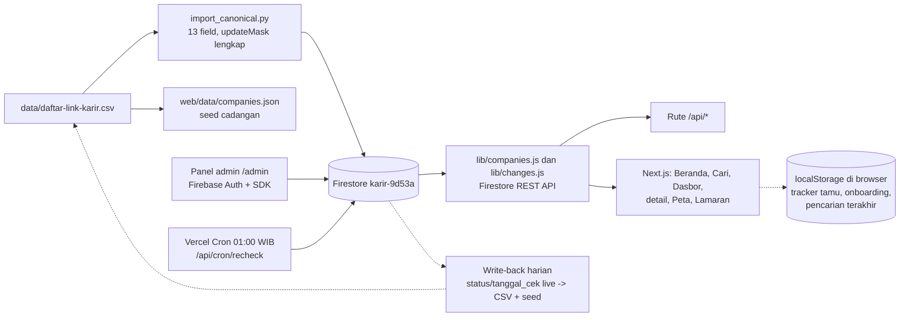

# Arsitektur

## Alur data

Sumber data adalah `data/daftar-link-karir.csv`: 610 perusahaan, 13 kolom,
masing-masing kanal karirnya dibuka dan diperiksa langsung; tanggal cek per
baris tercatat di kolom `tanggal_cek`. File itu sumber kebenaran untuk isi
data. Aplikasi live tidak membaca CSV; aplikasi membaca Firestore.

Impor kanonis memakai `import_canonical.py` (di luar repo, di samping
skrip-skrip operasional lain): membaca CSV langsung, menulis ke-13 field
per dokumen dengan `updateMask` lengkap — PATCH tanpa `updateMask` dilarang
karena bisa menghapus field. Dokumen baru dibuat lewat POST create dengan
ID dokumen sama dengan nomor baris. Skrip impor lama
(`import_firestore.py`, 9 field) sudah tidak dipakai lagi. Skrip impor di
repo (`web/scripts/import-firestore.mjs`) masih menulis 9 field dan belum
diperbarui — jangan dipakai sampai diperbaiki atau dihapus.

## Sumber kebenaran data (keputusan S1, 14 Nov 2026)

CSV adalah sumber kebenaran abadi untuk SEMUA field; Firestore adalah
cermin live. Seed (`web/data/companies.json`) adalah salinan CSV untuk
cadangan saat Firestore tidak bisa dijangkau — isinya harus selalu sama
persis dengan CSV (dijaga `scripts/check-consistency.py` di CI).

Sinkron berjalan dua jalur, karena cron cek ulang menulis ke Firestore
langsung (ia tidak punya akses tulis ke CSV):

- **CSV → Firestore** (data baru dan perbaikan): hunting dan impor
  kanonis menulis data baru ke CSV + seed, lalu
  `import_canonical.py` menulis ke-13 field ke Firestore.
- **Firestore → CSV** (status dan tanggal cek live): write-back harian
  membaca koleksi `changes` 24 jam terakhir plus selisih `tanggal_cek`,
  lalu menerapkan nilai live yang lebih baru ke CSV + seed. Nilai live
  yang lebih baru hanya sah bila didukung bukti (entri `changes` atau
  log recheck); bila ragu, barisnya dicatat untuk cek ulang, bukan
  ditebak.

Aturan jendela: data live boleh lebih baru dari CSV maksimal 24 jam
(jeda sampai write-back berikutnya). Bila live lebih tua dari CSV, atau
lebih baru lebih dari 24 jam, `scripts/check-consistency.py --live`
gagal — itu tanda write-back macet dan harus diperiksa.

## Koleksi Firestore

Proyek `karir-9d53a`, region asia-southeast1, paket Spark. Empat koleksi:

| Koleksi | Isi | Baca | Tulis |
| --- | --- | --- | --- |
| `companies` | 610 dokumen, satu per perusahaan | Terbuka | Admin login, dokumen harus lolos validasi (9 kolom wajib, `no` angka, status salah satu dari 4 nilai; `batas_lamar` opsional, bila ada harus string) |
| `changes` | Perubahan status dari cek ulang harian | Terbuka | Admin login, 6 kolom wajib, `from` dan `to` salah satu dari 4 status; tidak bisa diubah atau dihapus |
| `audit_logs` | Jejak perubahan data oleh admin | Admin login | Admin login; tidak bisa diubah atau dihapus |
| `reports` | Laporan tautan mati dari pengunjung | Admin login | Siapa pun, bentuk divalidasi (`no` angka, `alasan` 1 sampai 499 karakter); tidak bisa diubah atau dihapus |

Aturannya ada di `web/firestore.rules`. Aturan untuk `changes` sudah ditulis di file itu dan menunggu diterbitkan dari Firebase Console.

## Lapisan baca

Aplikasi membaca Firestore lewat REST API (`fetch` biasa) di `lib/companies.js` dan `lib/changes.js`, dengan timeout 10 detik untuk daftar perusahaan dan 5 detik untuk umpan perubahan. Cache memori server 5 menit; admin yang menulis data memanggil `revalidateCompanies()` supaya cache dibersihkan. Daftar perusahaan diambil per halaman 300 dokumen dengan `pageToken` sampai habis.

SDK JS Firestore (gRPC) tidak dipakai untuk baca server karena tidak menembus proxy egress di lingkungan build: request-nya timeout lalu mengembalikan 0 baris tanpa error yang jelas. REST terbukti andal di jalur yang sama, termasuk saat impor 406 dokumen.

Pencarian dan skor tinggal di `lib/search.js`, fungsi murni tanpa DOM: posisi cocok +50, domisili cocok +30, lowongan terverifikasi +20, portal mati -20, tidak dapat diverifikasi -10. Sinonim peran diperluas sebelum dicocokkan (cleaner menemukan Cleaning Service, warehouse menemukan Staff Gudang), dan kalimat penyangkalan dalam radius 60 karakter tidak dihitung sebagai kecocokan.

Cek satu tautan tinggal di `lib/check.js`: HEAD dulu, lanjut GET bila server menolak HEAD dengan 405 atau 501, maksimal 5 redirect, timeout 8 detik (10 detik bila dipanggil rute admin). Dipakai panel admin dan cron, supaya logikanya satu tempat.

## Lapisan tulis

Tulis hanya lewat dua jalur.

Admin di `/admin` login dengan Firebase Auth (Email/Password) lewat SDK di browser (`lib/firebase.js`), lalu menulis langsung ke Firestore. Aturan Firestore yang memvalidasi tulisannya. Setiap perubahan dicatat di `audit_logs`.

Cron harian (`GET /api/cron/recheck`, dijadwalkan Vercel Cron tiap 18:00 UTC, 01:00 WIB, lihat `web/vercel.json`) menulis lewat REST API memakai access token dari service account (`FIREBASE_SERVICE_ACCOUNT`, string JSON di env Vercel). Token dibuat dari JWT RS256 yang ditandatangani `node:crypto`, tanpa dependensi baru. Anggaran waktu 50 detik, cek paralel batch 5. Antrean berisi perusahaan yang ada lowongannya dan portal yang sedang berstatus mati (supaya ada jalan pulih), diurutkan dari yang paling lama tidak dicek supaya cek harian berputar ke seluruh daftar. Bila waktu habis, sisanya dicatat terpotong dan menunggu hari berikut.

Cek tautan hanya membuktikan portal bisa dibuka, bukan lowongannya masih ada. Karena itu pemetaan statusnya hati-hati: perusahaan yang ada lowongannya dan portanya mati jadi `Portal tidak bisa dibuka` dan tercatat di `changes`; perusahaan yang ada lowongannya dan portalnya hidup hanya diperbarui tanggal ceknya; portal mati yang hidup lagi jadi `Tidak dapat diverifikasi` sampai dicek ulang manusia.

## Yang tidak menyentuh server (untuk tamu)

Pengunjung yang tidak masuk (tamu) memakai aplikasi tanpa akun: tracker
lamaran, pilihan onboarding, dan pencarian terakhir hanya tersimpan di
`localStorage` browser mereka, dan tidak ada yang dikirim ke server.
Halaman `/pengaturan` menunjukkan apa yang tersimpan dan bisa
menghapusnya.

Pengunjung yang masuk dengan akun (Firebase Auth, opsional) mendapat
sinkronisasi tracker: data pelacak lamaran mereka tersimpan di akun
(subkoleksi `user_trackers/{uid}/items`) supaya tetap ada di perangkat
lain. Analitik pengunjung berjalan untuk semua pengunjung: event anonim
(pageview, pencarian, klik portal, dan sejenisnya) dikirim ke
`/api/analytics` dengan ID pengunjung acak yang dibuat sekali di
`localStorage` — tanpa nama, tanpa alamat email, tanpa data pribadi.

## Keputusan arsitektur

- Datanya tinggal di Firestore. Akun Supabase sudah mencapai batas 2 proyek gratis yang aktif, dan keduanya sedang live. Vercel KV tidak dipakai karena data ini butuh database dokumen dengan query dan aturan tulis.
- Akun pengguna opsional. Pengunjung bisa memakai aplikasi tanpa akun
  (tracker tersimpan lokal di browser). Yang masuk dengan akun
  (Firebase Auth) mendapat sinkronisasi tracker ke server: data
  pelacak lamaran tersimpan di akun mereka (`user_trackers/{uid}/items`).
  Akun admin terpisah dan dipakai untuk mengelola data.
- Tanpa payment gateway. Aplikasi tidak memungut pembayaran apa pun.
- Hosting di Vercel, proyek `karir`, rootDirectory `web`. Setiap push ke `main` men-deploy otomatis. Deployment Protection dimatikan.
- Analitik berjalan (event anonim pengunjung, tanpa data pribadi — lihat
  "Yang tidak menyentuh server (untuk tamu)" di atas); tidak ada font
  eksternal. Angka di semua halaman dihitung dari data, bukan ditulis tangan.
