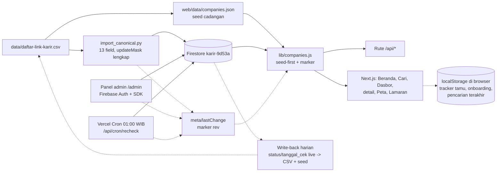

# Arsitektur

## Alur data

Sumber data adalah `data/daftar-link-karir.csv`: satu baris per perusahaan, 13 kolom,
masing-masing kanal karirnya dibuka dan diperiksa langsung; tanggal cek per
baris tercatat di kolom `tanggal_cek`. File itu sumber kebenaran untuk isi
data. Aplikasi live tidak membaca CSV; aplikasi membaca Firestore.

Impor kanonis memakai `import_canonical.py` (di luar repo, di samping
skrip-skrip operasional lain): membaca CSV langsung, menulis ke-13 field
per dokumen dengan `updateMask` lengkap. PATCH tanpa `updateMask` dilarang
karena bisa menghapus field. Dokumen baru dibuat lewat POST create dengan
ID dokumen sama dengan nomor baris. Skrip impor lama
(`import_firestore.py`, 9 field) sudah tidak dipakai lagi. Skrip impor di
repo (`web/scripts/import-firestore.mjs`) masih menulis 9 field dan belum
diperbarui. Jangan dipakai sampai diperbaiki atau dihapus.

## Sumber kebenaran data (keputusan S1, 14 Nov 2026)

CSV adalah sumber kebenaran abadi untuk SEMUA field; Firestore adalah
cermin live. Seed (`web/data/companies.json`) adalah salinan CSV untuk
cadangan saat Firestore tidak bisa dijangkau. Isinya harus selalu sama
persis dengan CSV (dijaga `scripts/check-consistency.py` di CI).

Sinkron berjalan dua jalur, karena cron cek ulang menulis ke Firestore
langsung (ia tidak punya akses tulis ke CSV):

- **CSV → Firestore** (data baru dan perbaikan): hunting dan impor
  kanonis menulis data baru ke CSV + seed, lalu
  `import_canonical.py` menulis ke-13 field ke Firestore.
- **Firestore → CSV** (status dan tanggal cek live): write-back harian
  membaca koleksi `changes` 24 jam terakhir plus selisih `tanggal_cek`,
  lalu menerapkan nilai live yang lebih baru ke CSV + seed. Nilai live
  yang lebih baru hanya sah bila didukung bukti (entri `changes` atau
  log recheck); bila ragu, barisnya dicatat untuk cek ulang, bukan
  ditebak.

Aturan jendela: data live boleh lebih baru dari CSV maksimal 24 jam
(jeda sampai write-back berikutnya). Bila live lebih tua dari CSV, atau
lebih baru lebih dari 24 jam, `scripts/check-consistency.py --live`
gagal. Itu tanda write-back macet dan harus diperiksa.

## Arsitektur seed-first (keputusan S3, 15 Nov 2026)

Latar: 15 Nov 2026 sekitar 00:15 WIB, kuota baca harian Firestore paket
Spark (50.000 baca/hari, reset 15:00 WIB) habis. Semua baca
mengembalikan 429 RESOURCE_EXHAUSTED dan `/api/stats`, `/api/companies`,
`/api/index` menjawab 503. Akarnya: lapisan baca lama memuat daftar
penuh (satu baca per dokumen) tiap cache 5 menit habis di tiap instance serverless,
jadi baca dokumen menumpuk sepanjang hari.

Perbaikan (T15): seed menjadi DEFAULT, Firestore hanya di-refill bila
ada bukti data berubah.

- **Seed dulu.** `getCompanies()` menyajikan `web/data/companies.json`
  sebagai default. Seed adalah salinan CSV yang dijaga
  `check-consistency.py`, jadi isinya data asli dengan tanggal cek
  aslinya.
- **Marker kecil.** Satu dokumen `meta/lastChange`
  `{rev, updatedAt, counterDay, refillsToday, readsEstimate}` dibaca
  1 baca per jendela TTL 5 menit (cache memori + dedup inflight).
  Refill penuh dari Firestore (satu baca per dokumen) HANYA bila `rev` berubah
  sejak refill terakhir, atau saat instance dingin pertama kali.
- **Yang menaikkan rev:** cron cek ulang (bila ada status berubah atau
  tanggal_cek diperbarui), impor kanonis (bila ada dokumen tertulis),
  panel admin (bila ada simpan/hapus/impor). Tulis tidak kena kuota
  baca. Tanpa perubahan, marker tidak disentuh.
- **Degradasi tanpa 503.** Baca marker gagal (429/offline/error apa
  pun) atau refill gagal (429) -> sajikan seed atau cache live lama,
  tanpa melempar. Rute API tetap 200 dan respons membawa
  `source: "live" | "seed"` + `seedDate`; klien menampilkan catatan
  "data cadangan" bila `source=seed`.
- **Self-metering (FIN-02).** Tiap refill menaikkan pencacah di marker
  (1 tulis PATCH, best-effort): `refillsToday` +1,
  `readsEstimate` += jumlah dokumen. Panel admin menampilkan estimasi
  pemakaian dari marker (1 baca). Begitu estimasi mencapai 70% kuota
  harian (35.000 baca), satu alert tipe `quota` dibuat di koleksi
  `alerts` (id deterministik `quota-70-{tanggal}`, satu per hari).
- **Batas hemat lain (FIN-04/FIN-05).** Seksi admin Jejak, Laporan,
  dan Pengunjung dimuat malas (saat dibuka) dengan batas lebih kecil;
  umpan `changes` di-cache memori 1 jam (berubah maks 1x sehari);
  `getCompanyById` di-cache 5 menit + dedup inflight; perusahaan
  sejenis dihitung dari seed, bukan dari daftar penuh.
- **Cron tidak boleh jalan dari seed.** Cron adalah penulis: bila data
  yang dimuat berasal dari seed (Firestore tidak bisa dibaca), run
  dilewati dengan 503 supaya tidak ada alert palsu atau tulis dari
  data basi.

Perkiraan pemakaian setelah perbaikan: instance hangat memakai ~1 baca
marker per 5 menit (~288/hari/instance) + 1 refill (~1 baca per dokumen) per
perubahan data, dua orde di bawah pola lama.

## Koleksi Firestore

Proyek `karir-9d53a`, region asia-southeast1, paket Spark.

| Koleksi | Isi | Baca | Tulis |
| --- | --- | --- | --- |
| `companies` | Satu dokumen per perusahaan | Terbuka | Admin login, dokumen harus lolos validasi (9 kolom wajib, `no` angka, status salah satu dari 4 nilai; `batas_lamar` opsional, bila ada harus string) |
| `changes` | Perubahan status dari cek ulang harian | Terbuka | Admin login, 6 kolom wajib, `from` dan `to` salah satu dari 4 status; tidak bisa diubah atau dihapus |
| `audit_logs` | Jejak perubahan data oleh admin | Admin login | Admin login; tidak bisa diubah atau dihapus |
| `reports` | Laporan tautan mati dari pengunjung | Admin login | Siapa pun, bentuk divalidasi (`no` angka, `alasan` 1 sampai 499 karakter); tidak bisa diubah atau dihapus |
| `alerts` | Alert notifikasi (`new-target`, `deadline`, `quota`) | Terbuka | Admin login; alert `quota` boleh dibuat server lewat API key publik dengan bentuk terkekang; tidak bisa diubah atau dihapus |
| `meta` | `targets` (snapshot cron) dan `lastChange` (marker kesegaran seed-first) | `lastChange` terbuka; sisanya tertutup | `lastChange`: rev hanya admin/service account, pencacah refill hanya naik 1 per tulis; `targets` hanya service account |
| `rate_limits` | Satu dokumen per hash pengunjung harian: larik waktu hit (maks 60 angka) dan cap waktu tulis balik; isinya hanya angka waktu, tanpa IP mentah | Terbuka | Siapa pun lewat API key publik, bentuk dibatasi ketat; tidak bisa dihapus |
| `user_trackers` | Subkoleksi `user_trackers/{uid}/items`: satu dokumen per perusahaan yang ditandai pengunjung yang masuk | Hanya pemilik akun | Hanya pemilik akun; bentuk divalidasi (status salah satu dari 4 nilai pelacak, tanggal, catatan maks 200 karakter) |
| `user_profiles` | Profil akun: email dan nama tampilan | Hanya pemilik akun atau admin | Hanya pemilik akun; tidak bisa dihapus |
| `analytics_events` | Event analitik pengunjung anonim (pageview, pencarian, klik portal, dan sejenisnya) | Admin login | Server saja yang menulis, lewat token service account; penulisan dari klien ditutup total; ubah dan hapus hanya admin |

Aturannya ada di `web/firestore.rules`.

## Lapisan baca

Aplikasi membaca Firestore lewat REST API (`fetch` biasa) di `lib/companies.js` dan `lib/changes.js`, dengan timeout 10 detik untuk daftar perusahaan dan 5 detik untuk umpan perubahan dan marker. Polanya seed-first (keputusan S3, lihat bagian di atas): seed adalah default, marker `meta/lastChange` dicek 1 baca per 5 menit, dan refill daftar penuh (per halaman 300 dokumen dengan `pageToken` sampai habis) hanya bila rev marker berubah. Umpan perubahan di-cache memori 1 jam. Marker adalah mekanisme invalidasi lintas-instance untuk serverless; `revalidateCompanies()` hanya membersihkan cache instance ini.

SDK JS Firestore (gRPC) tidak dipakai untuk baca server karena tidak menembus proxy egress di lingkungan build: request-nya timeout lalu mengembalikan 0 baris tanpa error yang jelas. REST terbukti andal di jalur yang sama, termasuk saat impor awal 406 dokumen.

Pencarian dan skor tinggal di `lib/search.js`, fungsi murni tanpa DOM: posisi cocok +50, domisili cocok +30, lowongan terverifikasi +20, portal mati -20, tidak dapat diverifikasi -10. Sinonim peran diperluas sebelum dicocokkan (cleaner menemukan Cleaning Service, warehouse menemukan Staff Gudang), dan kalimat penyangkalan dalam radius 60 karakter tidak dihitung sebagai kecocokan.

Cek satu tautan tinggal di `lib/check.js`: HEAD dulu, lanjut GET bila server menolak HEAD dengan 405 atau 501, maksimal 5 redirect, timeout 8 detik (10 detik bila dipanggil rute admin). Dipakai panel admin dan cron, supaya logikanya satu tempat.

## Lapisan tulis

Tulis hanya lewat dua jalur.

Admin di `/admin` login dengan Firebase Auth (Email/Password) lewat SDK di browser (`lib/firebase.js`), lalu menulis langsung ke Firestore. Aturan Firestore yang memvalidasi tulisannya. Setiap perubahan dicatat di `audit_logs`.

Cron harian (`GET /api/cron/recheck`, dijadwalkan Vercel Cron tiap 18:00 UTC, 01:00 WIB, lihat `web/vercel.json`) menulis lewat REST API memakai access token dari service account (`FIREBASE_SERVICE_ACCOUNT`, string JSON di env Vercel). Token dibuat dari JWT RS256 yang ditandatangani `node:crypto`, tanpa dependensi baru. Anggaran waktu 50 detik, cek paralel batch 5. Antrean berisi perusahaan yang ada lowongannya dan portal yang sedang berstatus mati (supaya ada jalan pulih), diurutkan dari yang paling lama tidak dicek supaya cek harian berputar ke seluruh daftar. Bila waktu habis, sisanya dicatat terpotong dan menunggu hari berikut.

Cek tautan hanya membuktikan portal bisa dibuka, bukan lowongannya masih ada. Karena itu pemetaan statusnya hati-hati: perusahaan yang ada lowongannya dan portanya mati jadi `Portal tidak bisa dibuka` dan tercatat di `changes`; perusahaan yang ada lowongannya dan portalnya hidup hanya diperbarui tanggal ceknya; portal mati yang hidup lagi jadi `Tidak dapat diverifikasi` sampai dicek ulang manusia.

## Apa yang tersimpan di browser, apa yang dikirim ke server

Tamu (pengunjung yang tidak masuk) memakai aplikasi tanpa akun. Tiga
hal hanya tersimpan di `localStorage` browser mereka dan tidak pernah
dikirim ke server: tandaan pelacak lamaran, pilihan onboarding, dan
daftar pencarian terakhir yang ditampilkan kembali ke mereka.
Halaman `/pengaturan` menunjukkan apa yang tersimpan dan bisa
menghapusnya.

Kata kunci pencarian adalah pengecualian: setiap pencarian dicatat
sebagai event analitik anonim (field `q` di koleksi
`analytics_events`), bersama pageview, klik portal, dan event
sejenisnya, lewat `/api/analytics`. Ini berlaku untuk semua
pengunjung, termasuk tamu. Event itu membawa ID pengunjung acak yang
dibuat sekali di browser (kunci `karir-visitor` di `localStorage`)
dan hash IP (SHA-256 dari alamat IP ditambah garam server) untuk
menghitung pengunjung unik per hari. IP mentah, nama, dan alamat
email tidak pernah disimpan. Aturan Firestore menutup penulisan dari
klien untuk koleksi itu; hanya server yang menulis, lewat token
service account. Rincinya ada di halaman
Kebijakan Privasi (`/privasi`).

Pengunjung yang masuk dengan akun (Firebase Auth, opsional) mendapat
sinkronisasi tracker: data pelacak lamaran mereka tersimpan di akun
(subkoleksi `user_trackers/{uid}/items`) supaya tetap ada di perangkat
lain.

## Keputusan arsitektur

- Datanya tinggal di Firestore. Akun Supabase sudah mencapai batas 2 proyek gratis yang aktif, dan keduanya sedang live. Vercel KV tidak dipakai karena data ini butuh database dokumen dengan query dan aturan tulis.
- Akun pengguna opsional. Pengunjung bisa memakai aplikasi tanpa akun
  (tracker tersimpan lokal di browser). Yang masuk dengan akun
  (Firebase Auth) mendapat sinkronisasi tracker ke server: data
  pelacak lamaran tersimpan di akun mereka (`user_trackers/{uid}/items`).
  Akun admin terpisah dan dipakai untuk mengelola data.
- Tanpa payment gateway. Aplikasi tidak memungut pembayaran apa pun.
- Hosting di Vercel, proyek `karir`, rootDirectory `web`. Setiap push ke `main` men-deploy otomatis. Deployment Protection dimatikan.
- Analitik berjalan untuk semua pengunjung (event anonim, tanpa nama,
  tanpa alamat email, dan tanpa alamat IP mentah; rinciannya di bagian
  "Apa yang tersimpan di browser, apa yang dikirim ke server" di atas).
  Tidak ada font eksternal. Angka di semua halaman dihitung dari data,
  bukan ditulis tangan.
